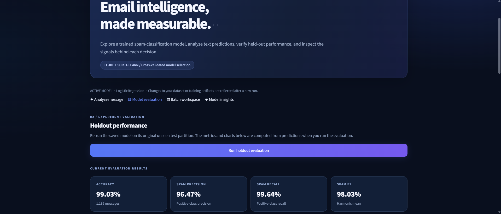
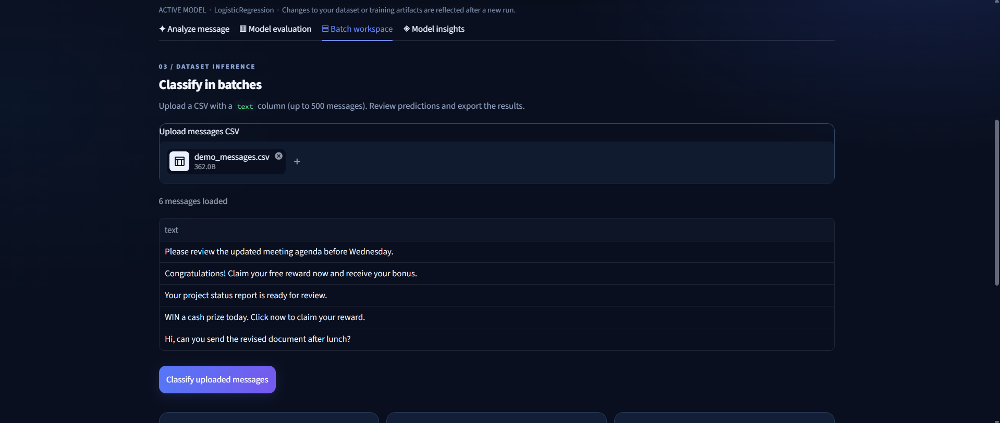
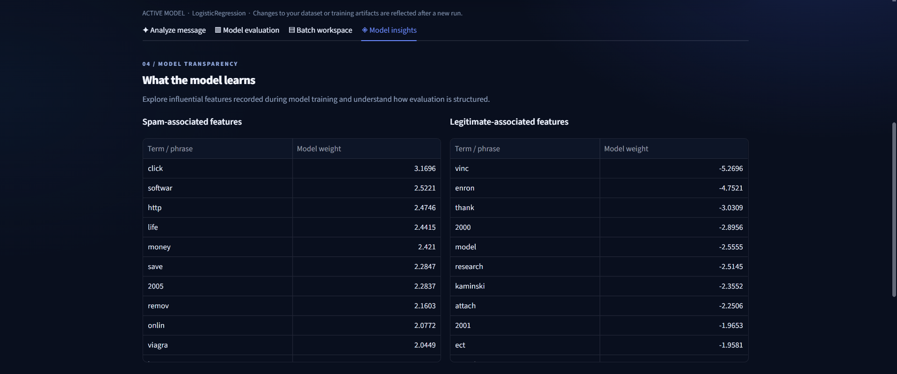
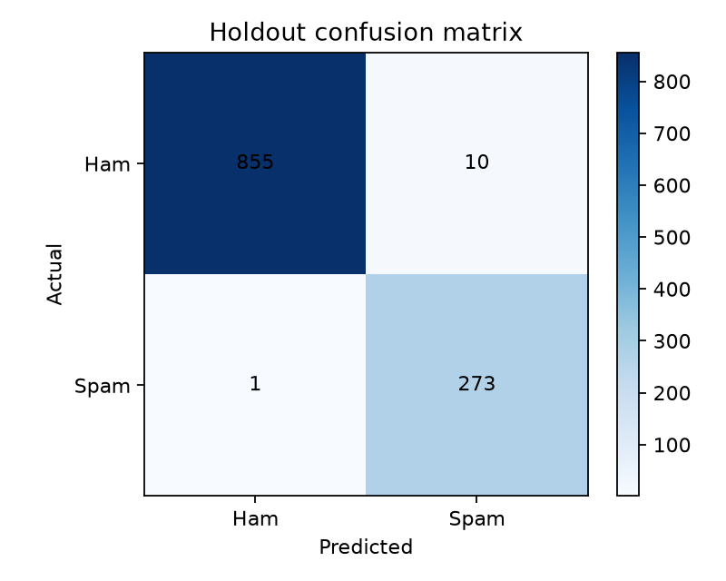
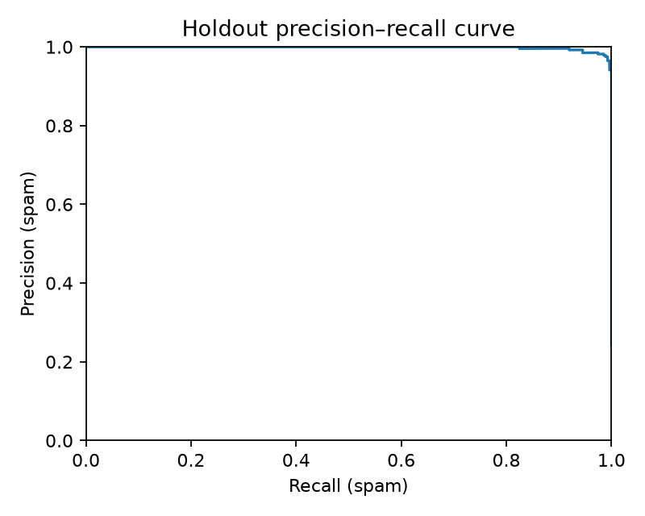
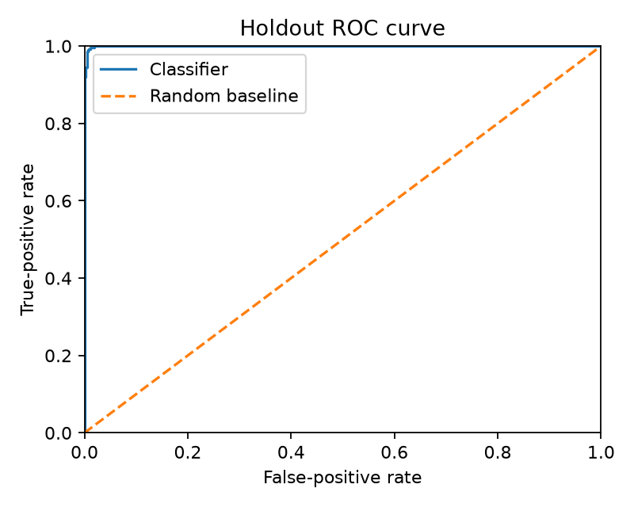

# 📧 Email Spam Classifier — Reproducible NLP & Machine Learning

A **Python-based email spam detection system** that classifies message text as **Spam** or **Not Spam** using natural language processing, TF-IDF features, and supervised machine learning. Beyond predicting a label, this project provides a **leakage-safe experiment**, comparative model evaluation, reproducible reports, interpretable features, a prediction CLI, and an interactive local Streamlit dashboard.

**Python · scikit-learn · NLTK · Pandas · NumPy · Streamlit · Matplotlib · Pytest**

> **Project scope:** A reproducible text-classification and model-evaluation system with a local demonstration interface. It is **not** connected to a live inbox and does **not** provide phishing protection.

---

## Application Screenshots

**Live classification and feature explanations**


**Measured model evaluation**




**Model selection and batch inference**


<details>
<summary>Additional evaluation and interface screenshots</summary>






</details>

## 📌 Overview

Filtering unwanted email is a binary text-classification problem, but a working prediction is only one part of a trustworthy ML system. The more important questions are whether the evaluation uses unseen data, whether the chosen model performs consistently, and which kinds of mistakes it makes.

This project processes labeled email messages, trains and compares multiple classifiers, selects the best-performing model through **training-only stratified cross-validation**, and evaluates that model once on a previously unseen holdout set. It also exports the full fitted preprocessing-and-classification pipeline for subsequent predictions.

### 🎯 Objectives

- Convert raw email text into consistent numerical features for supervised classification.
- Prevent leakage from the held-out test data into feature fitting and model selection.
- Compare multiple algorithms using more than a single accuracy score.
- Make false positives, false negatives, and important model features inspectable.
- Reproduce results and run predictions with simple Python commands.

## ✨ Key Features

| Capability | Implementation |
|---|---|
| **Data quality checks** | Validates text and binary labels; removes empty and exact-duplicate messages before splitting |
| **NLP preprocessing** | Lowercasing, tokenization, stopword removal, and Porter stemming |
| **Text features** | TF-IDF unigrams/bigrams fitted inside each training fold |
| **Leakage prevention** | End-to-end scikit-learn `Pipeline` and an untouched held-out test set |
| **Model comparison** | Multinomial Naive Bayes, Bernoulli Naive Bayes, and class-balanced Logistic Regression |
| **Cross-validation** | Three-fold stratified CV on training data, with fixed random seed |
| **Evaluation** | Accuracy, spam precision/recall/F1, average precision, ROC-AUC, and confusion matrix |
| **Diagnostic reports** | Precision–recall / ROC plots, misclassification row IDs, and weighted text features |
| **Interactive web dashboard** | Local Streamlit UI for text prediction, scores, model diagnostics, and evaluation charts |
| **Batch classification** | Upload a CSV of messages, preview labels/scores, and export predictions |
| **Prediction transparency** | Per-message TF-IDF × model-coefficient contributions for the selected linear classifier |
| **Prediction CLI** | Interactive CLI, single-message command, and JSON output |
| **Software reliability** | Automated Pytest checks and GitHub Actions CI |

## 🏗️ Architecture & Experiment Workflow

```text
Labeled email dataset (emails.csv)
              │
              ▼
       Validate / Clean
       Deduplicate Text
              │
              ▼
    Stratified 80/20 Split
              │
     ┌────────┴────────────────┐
     ▼                         ▼
TRAIN (4,556)             TEST (1,139)
     │                         │
     ▼                         │  Kept untouched during
3-Fold Stratified CV           │  feature fitting and
     │                         │  model selection
     ▼                         │
TF-IDF fitted per CV fold      │
     │                         │
     ├── Multinomial NB        │
     ├── Bernoulli NB          │
     └── Logistic Regression   │
     │                         │
     ▼                         │
Select by mean spam F1         │
     │                         │
     ▼                         │
Refit full pipeline on TRAIN   │
     └────────────┬────────────┘
                  ▼
        One Holdout Evaluation
                  │
                  ▼
       Metrics + Error Analysis
          + Plots + Model Card
                  │
                  ▼
        Saved Pipeline → CLI / Streamlit UI
```

**Why the design matters:** The original notebook fitted TF-IDF on the entire dataset before splitting, allowing holdout-document information to affect vocabulary and IDF statistics. The revised training path fixes this by fitting TF-IDF *inside* the cross-validated scikit-learn pipeline, and only on training data for the final model.

## 🔍 Dataset & Preprocessing

The project uses the **provided Kaggle-derived labeled email CSV**, with `text` and `spam` columns (`0` = legitimate email / ham; `1` = spam).

| Dataset stage | Emails |
|---|---:|
| Original labeled records | 5,728 |
| Exact duplicate texts removed | 33 |
| Usable, unique records | **5,695** |
| Training partition (80%) | 4,556 |
| Held-out test partition (20%) | 1,139 |

The train/test split is stratified by label with **random seed 42**. Text preprocessing uses lowercase alphanumeric tokenization, English stopword removal, and Porter stemming. TF-IDF uses unigrams and bigrams, capped at 5,000 features. The same fitted pipeline is used at inference time, preventing preprocessing mismatches between training and prediction.

> A stratified random split is appropriate for this **static email classification experiment**. It is **not** a time-series validation method and does not measure performance on future email distributions.

## 🧪 Model Training & Selection

Three models are compared with the same training folds and preprocessing approach. **Mean F1 on the positive (spam) class** is the selection metric. The final test set is not used to choose the winner.

### Training-only cross-validation

| Model | Mean spam F1 | CV standard deviation |
|---|---:|---:|
| Multinomial Naive Bayes | 0.9606 | 0.0081 |
| Bernoulli Naive Bayes | 0.8553 | 0.0217 |
| **Logistic Regression** | **0.9748** | **0.0033** |

**Selected model:** Class-balanced Logistic Regression, based on training-only cross-validation rather than the holdout result.

## 📊 Evaluation Results

The following values come from the **locally reproduced run on November 1, 2026, using Python 3.11**. The underlying machine-readable values are in [`artifacts/reports/metrics.json`](artifacts/reports/metrics.json).

<details>
<summary>Evaluation setup</summary>

- Dataset: 5,695 unique records after exact-text deduplication
- Split: stratified 80/20 with seed 42
- Cross-validation: 3 stratified folds on training records only
- Model selection: mean positive-class F1 across training folds
- Evaluation: selected model assessed once on 1,139 held-out emails

</details>

### Held-out test metrics

| Metric | Result |
|---|---:|
| **Accuracy** | **99.03%** |
| **Precision (spam)** | **96.47%** |
| **Recall (spam)** | **99.64%** |
| **F1-score (spam)** | **98.03%** |
| Average Precision (PR-AUC summary) | 0.99826 |
| ROC-AUC | 0.99946 |

### Confusion matrix

| Actual ↓ / Predicted → | Not Spam | Spam |
|---|---:|---:|
| **Not Spam (ham)** | **855** true negatives | **10** false positives |
| **Spam** | **1** false negative | **273** true positives |



*Generate the plots using the training command in your environment before publishing. The table above records the verified 855/10/1/273 local run.*

The model missed **1 of 274** spam messages but incorrectly flagged **10 of 865** legitimate emails. Those false positives matter in an email-filtering setting because legitimate messages could be incorrectly blocked or hidden.

### Additional diagnostic plots

| Precision–recall curve | ROC curve |
|---|---|
|  |  |

Supporting outputs: [CV comparison CSV](artifacts/reports/cv_model_comparison.csv) · [Misclassification index](artifacts/reports/holdout_errors.csv) · [Top model features](artifacts/reports/top_features.csv) · [Experiment Findings](artifacts/reports/EXPERIMENT_FINDINGS.md) · [Model Card](artifacts/model_card.md).

> **Important:** These results are limited to the supplied labeled dataset. The raw spam probabilities are **uncalibrated**; a high AUC or F1 does not establish reliability on a new mailbox, a newer corpus, or adversarial/phishing emails.

## 🔎 Error Analysis & Interpretation

The project records misclassified **row identifiers, actual labels, predicted labels, and model scores** without automatically exporting entire email bodies. A local inspection command lets a developer review individual mistakes.

The evaluation raises useful questions:

- **False positives:** Why did 10 legitimate emails look like spam? Some legitimate messages may share promotional language or formatting with the spam class; determining the actual causes requires inspecting those cases locally.
- **False negatives:** What allowed one spam message through? It is important to inspect that message before making conclusions about the failure mode.
- **Threshold trade-off:** Lowering the decision threshold may improve spam recall but usually creates additional false positives. Threshold tuning must use separate validation data, not the final holdout set.
- **Possible generalization limits:** The dataset is static and may contain dataset-specific word patterns. There is no external or chronological evaluation proving generalization to future mail.

The [Experiment Findings](artifacts/reports/EXPERIMENT_FINDINGS.md) document separates observed results from hypotheses and proposed further experiments.

## ⚙️ Run the Project

### Requirements

- Python **3.11** recommended
- Windows, Linux, or macOS
- Dependencies in [`requirements.txt`](requirements.txt); `requirements-dev.txt` adds Pytest

### 1. Install and test

From the repository's root folder on Windows (PowerShell **or** Command Prompt):

```powershell
py -3.11 -m venv .venv
.\.venv\Scripts\python.exe -m pip install -r requirements-dev.txt
.\.venv\Scripts\python.exe -m pytest -q
```

**Expected test output:** `10 passed`.

### 2. Train and reproduce the experiment

```powershell
.\.venv\Scripts\python.exe -m spam_classifier.train --data emails.csv --out artifacts
```

This creates or refreshes the complete model and reports under `artifacts/`, including the confusion matrix, CV comparison, metrics, error index, and model card. **Results may vary slightly across dependency versions; use your own generated `metrics.json` as the source of truth.** The narrative findings document and README are not automatically rewritten when training is rerun.

### 3. Predict spam

```powershell
# One email
.\.venv\Scripts\python.exe app.py --text "Claim your free cash prize now"

# JSON response
.\.venv\Scripts\python.exe app.py --text "Meeting moved to Thursday" --json

# Interactive input
.\.venv\Scripts\python.exe app.py
```

Prediction includes a spam/not-spam label. The reported spam probability is **not calibrated**.

### 4. Run the interactive web dashboard

Install the optional frontend dependency (the base CLI and training pipeline do **not** require Streamlit):

```powershell
.\.venv\Scripts\python.exe -m pip install -r requirements-ui.txt
.\.venv\Scripts\python.exe -m streamlit run dashboard.py
```

Open the **local URL** displayed in your terminal, usually `http://localhost:8501`.

The dashboard has four working views:

| View | Demonstrates |
|---|---|
| **Try a Message** | Text prediction, uncalibrated spam score, and recognized feature contributions |
| **Evaluation** | Live reading of saved holdout metrics, confusion matrix, CV model comparison, and evaluation curves |
| **Batch Classification** | Upload a CSV with a `text` column (1–500 rows), run inference, and download predictions; `demo_messages.csv` supplies fictional sample data |
| **Model Insights** | Top weighted text features, training protocol, and documented limits |

For a quick batch demonstration, upload [`demo_messages.csv`](demo_messages.csv).

**For portfolio screenshots**, use the [Screenshot Guide](SCREENSHOT_GUIDE.md). Screenshots should be taken from your actual running dashboard; no sample or fabricated result images are included. The dashboard reads your local `artifacts/reports/metrics.json`, so retrain first if you want to display your most recent verified results.

### 5. Investigate errors locally

```powershell
.\.venv\Scripts\python.exe -m spam_classifier.inspect_errors --kind false_positive --limit 3
.\.venv\Scripts\python.exe -m spam_classifier.inspect_errors --kind false_negative --limit 3
```

These commands may display message snippets in your local terminal; review them privately and do not publish sensitive contents.

## 📁 Project Structure

```text
email-spam-classifier/
├── README.md
├── emails.csv                         # Original labeled dataset
├── app.py                             # Interactive / text / JSON CLI
├── dashboard.py                       # Streamlit prediction + metrics + batch UI
├── requirements-ui.txt                # Optional Streamlit dependency
├── SCREENSHOT_GUIDE.md                # Guide to genuine app screenshots
├── demo_messages.csv                 # Fictional messages for batch demo
├── legacy_app.py                      # Preserved original CLI source
├── email-spam-detection.ipynb         # Historical notebook (leakage warning)
├── model.pkl, vectorizer.pkl          # Original model assets
├── requirements.txt
├── requirements-dev.txt
├── spam_classifier/
│   ├── data.py                        # Dataset validation and deduplication
│   ├── text.py                        # Tokenization, stopwords, stemming
│   ├── models.py                      # TF-IDF + classifier pipelines
│   ├── train.py                       # CV, training, evaluation, artifacts
│   ├── dashboard_utils.py             # Tested prediction/batch/explanation helpers
│   └── inspect_errors.py              # Local-only error review
├── notebooks/
│   └── leakage_safe_walkthrough.ipynb
├── tests/
│   ├── test_pipeline.py
│   └── test_dashboard_utils.py
├── artifacts/
│   ├── spam_pipeline.joblib           # Saved fitted pipeline
│   ├── model_card.md
│   └── reports/                      # Evaluation results + plots
└── .github/workflows/tests.yml        # CI test workflow
```

## 🧰 Technology Stack

| Technology | Role |
|---|---|
| Python | Core application, training and prediction code |
| scikit-learn | Pipelines, TF-IDF, model fitting, CV and evaluation |
| NLTK | Porter stemming |
| Pandas / NumPy | Dataset preparation and numerical processing |
| Matplotlib | Confusion matrix and evaluation curves |
| Streamlit | Local browser-based prediction and experiment dashboard |
| Joblib | Saving and loading the complete fitted pipeline |
| Pytest | Regression and leakage-related checks |
| GitHub Actions | Run tests on pushes and pull requests |

## ✅ Verification & Reproducibility

The expanded automated suite contains **16 passing tests** (10 original + 6 dashboard-focused), covering text/data validation, model pipeline behavior, saved-model inference, and an explicit check that a token appearing only in a held-out record is **not fitted into the training vocabulary**.

Run `python -m pytest -q` after modifying preprocessing or training code. Test completion does not automatically mean the statistical methodology is flawless; the train/validation/test protocol and independent evaluation remain essential.

The repository records the random seed, split sizes, training-only CV comparisons, held-out metrics, confusion matrix, library versions, and fitted pipeline. The saved `.joblib` model is intended for this trusted repository only; never deserialize untrusted pickle/joblib files.

## ⚠️ Scope & Limitations

- Classifies the **text** of one message; does not inspect attachments, sender reputation, URLs, or message headers.
- Does not connect to an actual Gmail/Outlook inbox or automatically block mail.
- Does **not** detect phishing or guarantee security outcomes.
- No temporal holdout, external validation corpus, probability calibration, or production drift monitoring.
- Exact duplicates are removed; semantic near-duplicates or templated messages may still require separate scrutiny.
- The legacy notebook is preserved for reference; its earlier TF-IDF-before-split evaluation should not be used to support current model claims.

## 🔮 Potential Next Improvements

Calibrated probability estimates, validation-only threshold selection, testing on a newer external dataset, and simple model-drift monitoring would be appropriate if the project were expanded beyond this portfolio experiment. These are **not claimed as implemented**.

## 👤 Maintainer

**Muhammad Abbas** — Software Engineer | Machine Learning & AI

[GitHub Profile](https://github.com/MdAbbas762)
