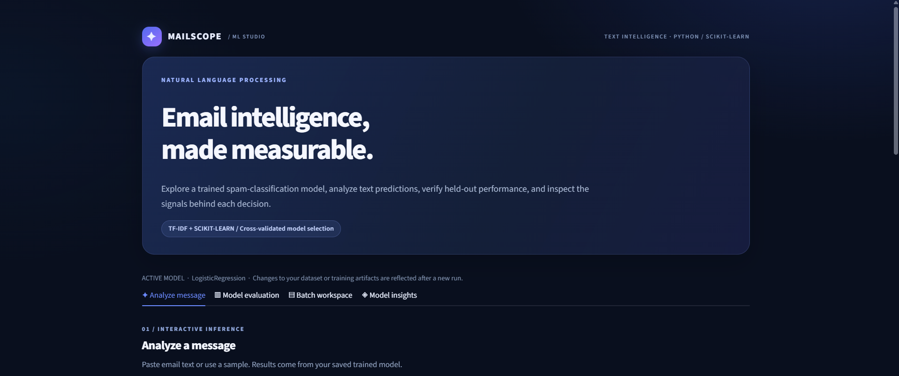
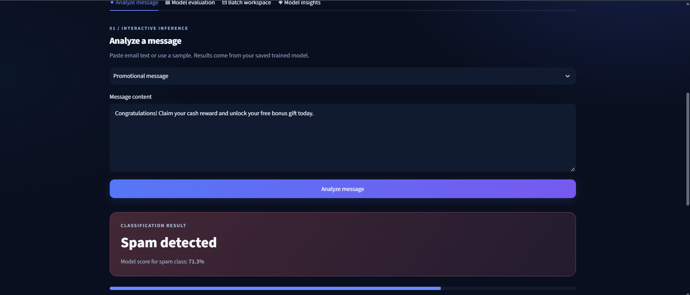
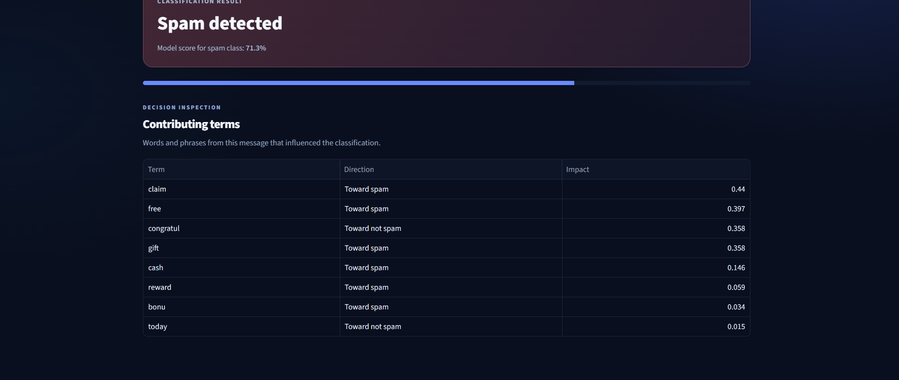
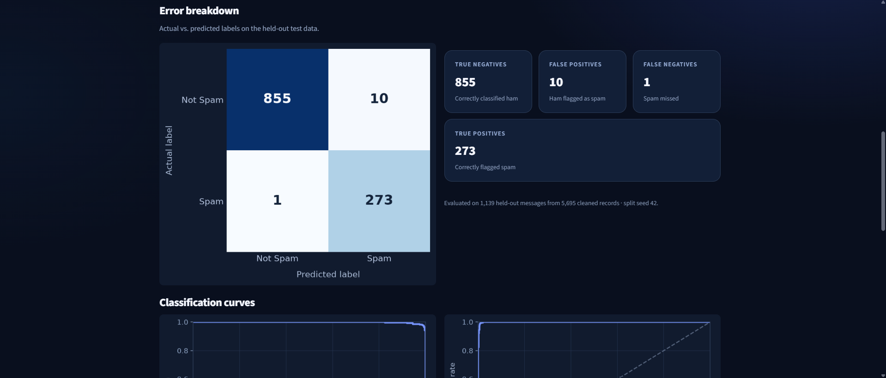
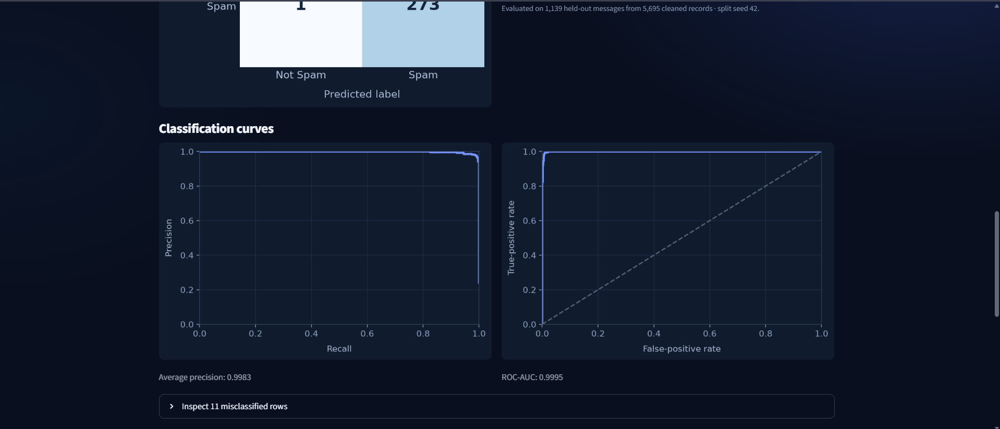
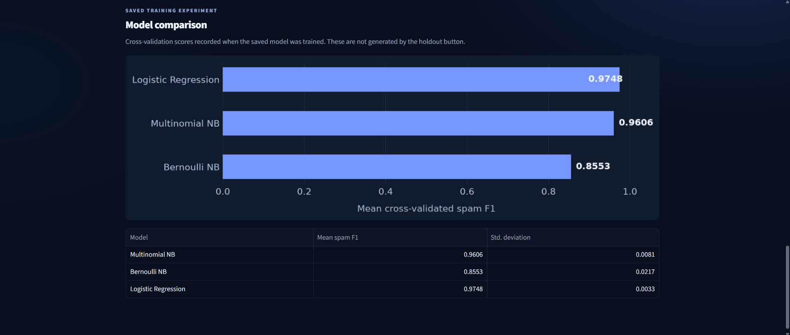
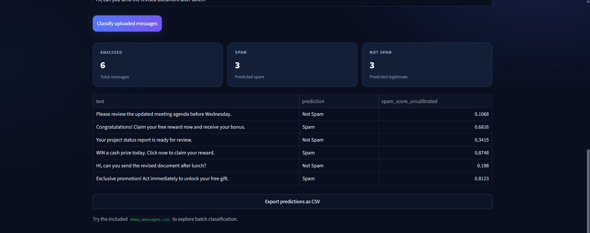

# 📧 MailScope — Email Spam Classification & ML Evaluation

**MailScope** is an interactive email classification and machine learning evaluation system built with **Python, scikit-learn, NLP, and Streamlit**. It transforms raw email text into numerical features, compares supervised classifiers, and identifies spam through a trained prediction pipeline. A dedicated dashboard brings together **live message analysis, decision explanations, held-out evaluation, model comparison, and batch CSV classification**.

**Python · scikit-learn · NLTK · Pandas · NumPy · Streamlit · Matplotlib · Pytest**

---

## 📌 Project Overview

MailScope connects the full text-classification workflow—from preparing labeled email data to training, evaluating, saving, and using an ML model—within one reproducible project.

Its training system cleans and validates email records, converts text into TF-IDF features, compares candidate classifiers through stratified cross-validation, and selects the strongest model based on spam-class F1-score. The selected pipeline is then evaluated on a reserved test partition and saved for reuse.

The **MailScope web application** makes the trained model accessible through a polished interface. Users can classify individual emails, inspect influential terms, evaluate the model against held-out data, compare training experiments, and process entire CSV files.

## 🎯 Project Objectives

- Build a complete NLP-based email classification pipeline with reusable training and inference components.
- Compare multiple supervised learning algorithms using consistent validation procedures.
- Keep model selection and feature fitting separate from held-out test evaluation.
- Provide clear classification results, measurable performance reports, and interpretable model decisions.
- Support both individual predictions and batch processing through a browser-based interface and CLI.

## ✨ Key Features

### 🤖 Intelligent Email Classification

Enter an email message into the MailScope dashboard to receive a **Spam** or **Not Spam** prediction. The application uses the fitted scikit-learn pipeline to preprocess the text, construct TF-IDF features, and return the selected classifier's output and spam-class score.

### 🔎 Explainable Predictions

For the selected Logistic Regression model, MailScope identifies terms from the submitted message that contribute to its classification. A decision-inspection table shows each term, whether it pushes the result toward spam or legitimate mail, and its relative contribution.

### 🧹 Automated Data Preparation

The data pipeline validates email texts and labels, removes unusable entries and duplicate messages, and applies lowercase normalization, tokenization, stopword filtering, and Porter stemming before feature extraction.

### 🧪 Comparative Model Training

MailScope trains and compares **Multinomial Naive Bayes, Bernoulli Naive Bayes, and Logistic Regression** through three-fold stratified cross-validation. TF-IDF feature fitting occurs within the training pipeline for each fold. The winning model is selected by mean spam F1-score and then fitted on the complete training partition.

### 📊 Interactive Performance Evaluation

The dashboard can rerun the saved model on its held-out test partition and calculate accuracy, spam precision, recall, F1-score, confusion matrix, precision–recall curve, and ROC curve. It also displays the saved cross-validation comparison from training.

### 📁 Batch Email Analysis

Upload a CSV containing a `text` column to classify up to **500 messages** in one operation. Review the predicted labels and model scores, inspect the spam/legitimate breakdown, and download the results as a CSV file.

### ⚙️ Reusable ML Engineering Workflow

Training, inference, evaluation, and dashboard functionality are organized into separate Python modules. The trained pipeline, experiment metrics, reports, and visualizations can be regenerated, while automated Pytest checks and GitHub Actions verify the core code paths.

## 🏗️ System Architecture

```text
                         Labeled Email Dataset
                                 │
                                 ▼
                    Validation & Deduplication
                                 │
                                 ▼
                    Stratified Train/Test Split
                          │             │
                          ▼             │
                    Training Data       │ Held-Out Test Data
                          │             │
                          ▼             │
               3-Fold Cross-Validation  │
                          │             │
                   TF-IDF Pipelines     │
                          │             │
              ┌───────────┼──────────┐  │
              ▼           ▼          ▼  │
         Multinomial   Bernoulli  Logistic
         Naive Bayes   Naive Bayes Regression
              └───────────┼──────────┘  │
                          ▼             │
                   Model Selection      │
                          │             │
                          ▼             ▼
                   Final Model → Holdout Evaluation
                          │             │
                          ▼             ▼
                  Saved ML Pipeline   Metrics & Reports
                          │             │
                          └──────┬──────┘
                                 ▼
                           MailScope UI
                   ┌─────────────┼──────────────┐
                   ▼             ▼              ▼
             Live Analysis  Model Evaluation  Batch Processing
```

### How predictions work

1. **Input:** A message is submitted through the dashboard, CLI, or batch upload.
2. **Preprocessing:** The text follows the same normalization and feature pipeline used during training.
3. **Inference:** The saved Logistic Regression classifier predicts the email category.
4. **Explanation:** For individual messages, the application derives term contributions from TF-IDF values and model coefficients.
5. **Output:** Results are displayed in the dashboard or exported through the CLI/CSV workflow.

## 🧠 Model Development & Evaluation

### Dataset and preparation

The project uses the labeled email dataset included as [`emails.csv`](emails.csv), with `spam = 1` representing spam and `spam = 0` representing legitimate messages.

| Data preparation stage | Records |
|---|---:|
| Original labeled messages | 5,728 |
| Exact duplicates removed | 33 |
| Cleaned dataset | **5,695** |
| Training partition (80%) | 4,556 |
| Held-out test partition (20%) | 1,139 |

The training workflow uses a **stratified 80/20 split with random seed 42** and a TF-IDF representation with unigrams and bigrams. Feature fitting and model selection are performed without using the held-out test partition.

### Cross-validation comparison

The three candidate algorithms were evaluated on the training partition using three-fold stratified cross-validation. **Mean spam F1-score** determined which classifier was selected.

| Classifier | Mean CV spam F1 | Standard deviation |
|---|---:|---:|
| Multinomial Naive Bayes | 0.9606 | 0.0081 |
| Bernoulli Naive Bayes | 0.8553 | 0.0217 |
| **Logistic Regression** | **0.9748** | **0.0033** |

**Selected model:** Logistic Regression, refitted on the full training partition after model selection.

## 📊 Experimental Results

The results below were reproduced using the saved training workflow on **November 1, 2026**, with **1,139 held-out email messages**.

| Evaluation metric | Result |
|---|---:|
| **Accuracy** | **99.03%** |
| **Spam precision** | **96.47%** |
| **Spam recall** | **99.64%** |
| **Spam F1-score** | **98.03%** |
| Average precision | 0.99826 |
| ROC-AUC | 0.99946 |

### Classification breakdown

| Actual / Predicted | Not Spam | Spam |
|---|---:|---:|
| **Not Spam** | **855** true negatives | **10** false positives |
| **Spam** | **1** false negative | **273** true positives |

The classifier correctly identified **1,128 of 1,139** held-out messages. The evaluation generated a confusion matrix, precision–recall curve, ROC curve, and **11 misclassification records** for further inspection.

Detailed results are available in [`metrics.json`](artifacts/reports/metrics.json), the [Experiment Findings](artifacts/reports/EXPERIMENT_FINDINGS.md), and the [Model Card](artifacts/model_card.md).

## 🖥️ Application Walkthrough

The screenshots below were captured from the running **MailScope Streamlit application**. They follow the product workflow from the main interface through individual inference, evaluation, batch processing, and model inspection.

### 01 — MailScope Interface

The application's main workspace introduces the classification and evaluation tools and provides navigation between its four functional sections.



### 02 — Live Spam Prediction

An incoming message is analyzed by the saved ML pipeline, producing a **Spam detected** result with the corresponding model score.



### 03 — Prediction Explanation

The decision-inspection table highlights influential words and phrases, showing their direction and contribution to the classification.



### 04 — Model Performance Metrics

The held-out evaluation displays accuracy, precision, recall, and F1-score calculated from the model's predictions against the test dataset.


### 05 — Confusion Matrix & Error Breakdown

A visual confusion matrix and companion result cards show correct classifications and false-positive/false-negative counts.



### 06 — Precision–Recall & ROC Curves

Evaluation curves summarize the classifier's behavior across decision thresholds and complement the headline performance metrics.



### 07 — Cross-Validated Model Comparison

The model comparison section visualizes the training-only cross-validation results for all three candidate classifiers and identifies the selected model.



### 08 — Batch Classification Workspace

The batch workspace accepts CSV uploads containing a `text` column and previews the messages before inference.


### 09 — Batch Prediction Results

After processing the uploaded CSV, MailScope displays class counts, individual predictions, model scores, and a downloadable results file.



### 10 — Model Insights & Feature Weights

The model-insights view presents spam-associated and legitimate-associated terms together with the evaluation workflow used to produce the trained classifier.


## 🛠️ Technology Stack

| Technology | Purpose |
|---|---|
| **Python** | Training, prediction, evaluation, and application logic |
| **scikit-learn** | TF-IDF pipelines, model training, cross-validation, and evaluation |
| **NLTK** | NLP preprocessing and Porter stemming |
| **Pandas / NumPy** | Dataset validation, transformation, and batch processing |
| **Streamlit** | Interactive classification and evaluation dashboard |
| **Matplotlib** | Confusion matrix and performance visualizations |
| **Joblib** | Persisting and reloading the trained prediction pipeline |
| **Pytest / GitHub Actions** | Automated testing and continuous integration |

## 🚀 Running MailScope

### 1. Set up the environment

Python **3.11** is recommended. From the repository root, run these commands in Windows PowerShell:

```powershell
py -3.11 -m venv .venv
.\.venv\Scripts\python.exe -m pip install -r requirements-dev.txt
.\.venv\Scripts\python.exe -m pip install -r requirements-ui.txt
```

### 2. Launch the interactive dashboard

```powershell
.\.venv\Scripts\python.exe -m streamlit run dashboard.py
```

Open the local URL printed in the terminal, normally **http://localhost:8501**. The saved trained pipeline is included in `artifacts/`, so the dashboard can be used without retraining.

### 3. Train the model and regenerate reports

```powershell
.\.venv\Scripts\python.exe -m spam_classifier.train --data emails.csv --out artifacts
```

This regenerates the fitted pipeline and evaluation assets, including metrics, model comparisons, plots, and error-analysis records.

### 4. Run CLI predictions

```powershell
# Single message
.\.venv\Scripts\python.exe app.py --text "Claim your free cash prize now"

# JSON result
.\.venv\Scripts\python.exe app.py --text "Meeting moved to Thursday" --json
```

For batch classification, use the dashboard's **Batch workspace** and the included [`demo_messages.csv`](demo_messages.csv).

### 5. Run automated tests

```powershell
.\.venv\Scripts\python.exe -m pytest -q
```

The expanded project test suite includes **17 automated tests**, covering the prediction pipeline, data handling, leakage-related checks, dashboard helpers, and held-out evaluation behavior.

## 📁 Repository Structure

```text
email-spam-classifier/
├── dashboard.py                    # MailScope Streamlit application
├── app.py                          # CLI and JSON predictions
├── emails.csv                      # Labeled email dataset
├── demo_messages.csv              # Sample batch messages
├── spam_classifier/
│   ├── data.py                     # Data cleaning and validation
│   ├── text.py                     # NLP preprocessing
│   ├── models.py                   # Classifier pipelines
│   ├── train.py                    # Training and evaluation
│   ├── dashboard_utils.py          # Dashboard prediction helpers
│   └── inspect_errors.py           # Misclassification inspection
├── artifacts/
│   ├── spam_pipeline.joblib        # Saved trained pipeline
│   ├── model_card.md
│   └── reports/                   # Metrics, curves, and diagnostics
├── tests/                         # Automated unit/integration checks
├── screenshots/                   # 10 application screenshots
├── notebooks/                     # Reproducible experiment walkthrough
├── .streamlit/config.toml         # Dashboard theme
├── .github/workflows/tests.yml    # CI workflow
├── requirements.txt
├── requirements-dev.txt
├── requirements-ui.txt
└── README.md
```

## 👨‍💻 Author

**Muhammad Abbas**

Software Engineer · Machine Learning & AI

[](https://github.com/MdAbbas762)
[](mailto:abbas63891@gmail.com)
