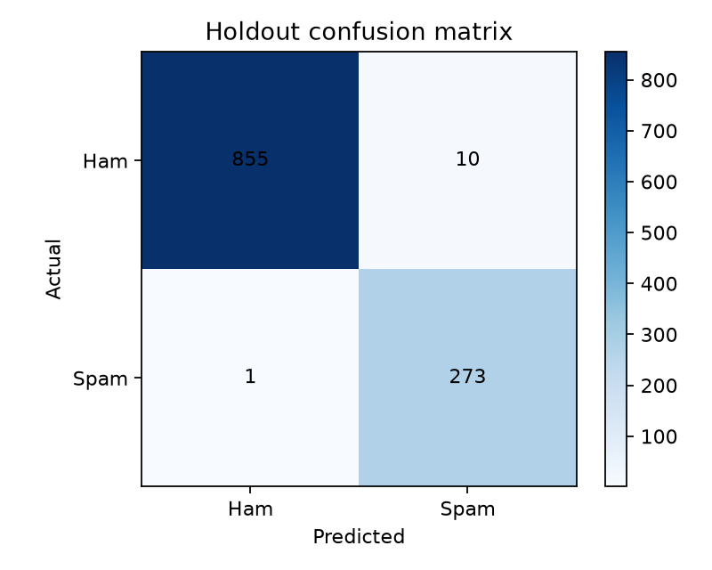

# 🔬 Experiment Findings — Email Spam Classification

This report explains the **locally reproduced November 1, 2026** run of the leakage-safe ML experiment. It records observed results, their interpretation, and limits that remain unresolved. Machine-readable details are in [`metrics.json`](metrics.json).

## 1. Dataset and evaluation setup

- Source: labeled email corpus supplied with the project (`emails.csv`).
- Original records: **5,728**; exact text duplicates removed: **33**; usable records: **5,695**.
- Split: stratified random **80% training / 20% held-out test**, random seed **42**.
- Partition sizes: **4,556** training emails and **1,139** holdout emails.
- Validation: **three-fold stratified cross-validation on training data only**.
- Feature engineering: TF-IDF fitted inside each fold and refitted exclusively on training records for the final model.
- Model selection criterion: mean F1 for spam, not held-out test performance.

## 2. Training-only model comparison

| Candidate | CV spam F1 (mean) | Standard deviation |
|---|---:|---:|
| Logistic Regression | **0.9748** | 0.0033 |
| Multinomial Naive Bayes | 0.9606 | 0.0081 |
| Bernoulli Naive Bayes | 0.8553 | 0.0217 |

**Observation:** Logistic Regression had the highest mean positive-class F1 in this experiment, so it was selected without using the test set.

**Interpretation:** The result compares the exact implementations and hyperparameters in this repository; it does not establish that Logistic Regression is always better for spam classification.

## 3. Held-out test performance

| Metric | Raw value | Display value |
|---|---:|---:|
| Accuracy | 0.9903424056 | **99.03%** |
| Precision (spam) | 0.9646643110 | **96.47%** |
| Recall (spam) | 0.9963503650 | **99.64%** |
| F1 (spam) | 0.9802513465 | **98.03%** |
| Average precision | 0.9982577905 | **0.99826** |
| ROC-AUC | 0.9994641576 | **0.99946** |

Confusion matrix (rows = actual `ham, spam`; columns = predicted `ham, spam`):

```text
[[855,  10],
 [  1, 273]]
```

This means **855 true negatives**, **273 true positives**, **10 false positives**, and **1 false negative**. The held-out set contains 865 legitimate emails and 274 spam emails.



## 4. Error-analysis questions

### False positives — 10 legitimate emails predicted as spam

These represent the highest operational concern if a filtering application automatically suppresses messages. A local inspection can help identify whether promotional vocabulary, formatting, or dataset artifacts contributed; those explanations **have not been confirmed without inspecting individual cases**.

```powershell
.\.venv\Scripts\python.exe -m spam_classifier.inspect_errors --kind false_positive --limit 5
```

### False negatives — 1 spam email predicted as legitimate

Investigate the message locally to understand what information the selected feature representation failed to use. One error alone is not enough to establish a general failure category.

```powershell
.\.venv\Scripts\python.exe -m spam_classifier.inspect_errors --kind false_negative --limit 5
```

Generated error tables contain identifiers and model scores but **not raw message contents** by default.

## 5. The methodology improvement

The original notebook fitted TF-IDF on the entire dataset before the train/test split. This means the holdout vocabulary and document frequencies could influence feature construction. The revised pipeline places feature fitting inside cross-validation and fits the final model using training data only. The holdout is evaluated **once after model selection**.

This improves the validity of the reported evaluation, although it cannot eliminate every form of data leakage. Exact duplicate messages are removed before splitting; near-duplicate or template-level overlap was not evaluated separately.

## 6. What the results do not prove

- There is **no evaluation on an independent modern email dataset**.
- There is **no time-separated holdout** and no measured distribution shift.
- Classification probabilities are **uncalibrated**; they are not validated confidence guarantees.
- No decision threshold was optimized against legitimate-email recovery costs.
- The system has not been deployed into a live inbox and does not evaluate phishing or attachments.
- A static-dataset test result does not imply effectiveness on financial-market time-series data.

## 7. Suggested next controlled experiment

On a **separate validation set**, compare a few classification thresholds using a cost-sensitive measure that penalizes wrongly blocked legitimate email. Lock the chosen threshold before testing it on a new external dataset. Do not repeatedly tune using the present holdout.

## Reproducibility

Run from the repository root:

```powershell
.\.venv\Scripts\python.exe -m spam_classifier.train --data emails.csv --out artifacts
```

The command updates the generated `metrics.json`, plots, model card, and CSV reports. This narrative document is a **fixed explanation of the November 1, 2026 local run**; if results differ on another environment, update this report to match the new `metrics.json` before publishing.
